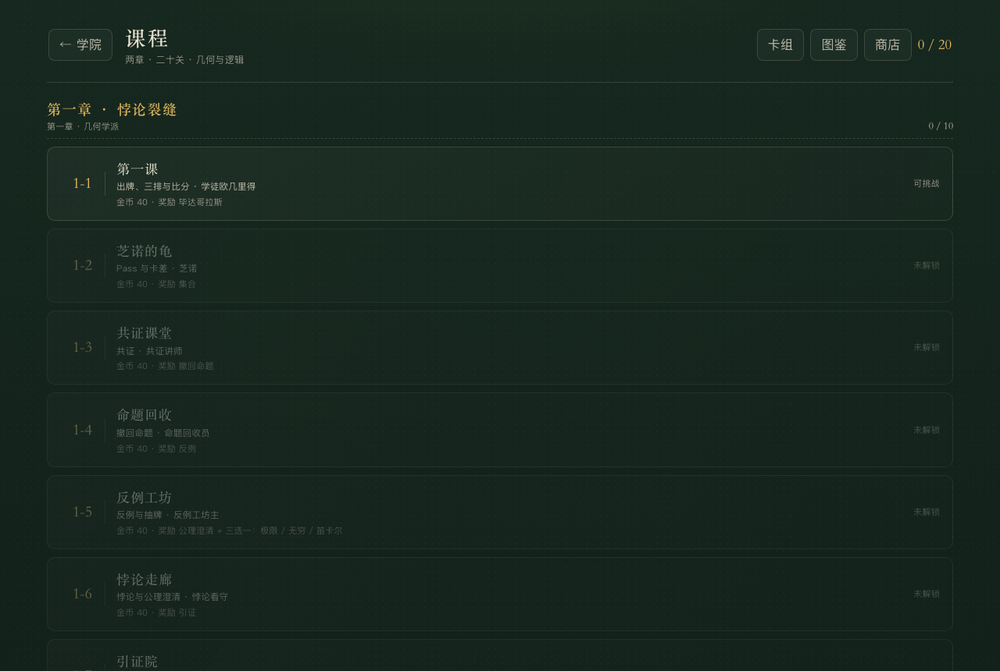
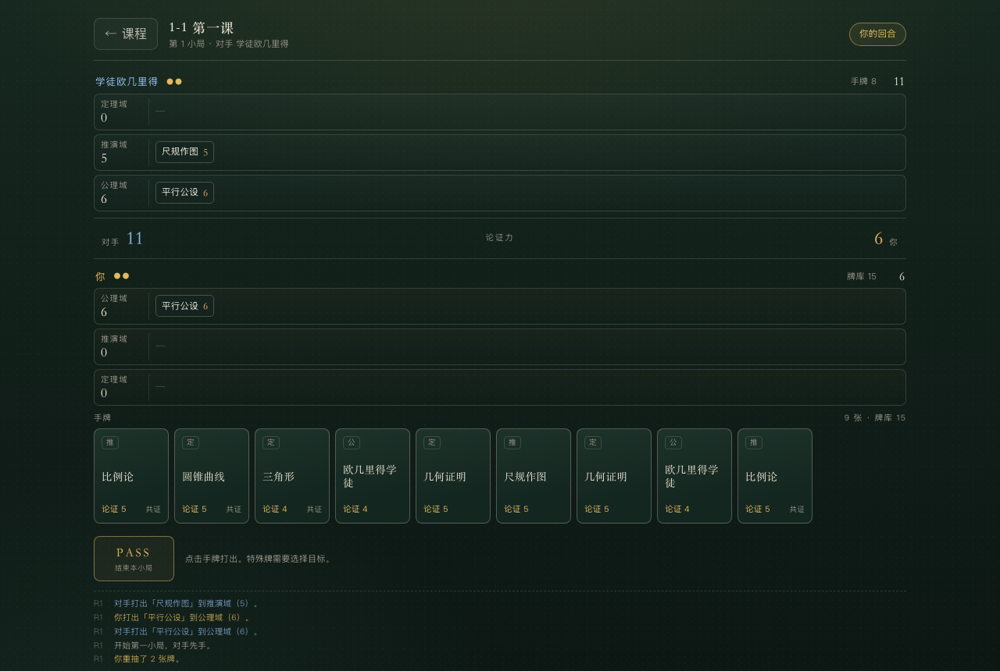
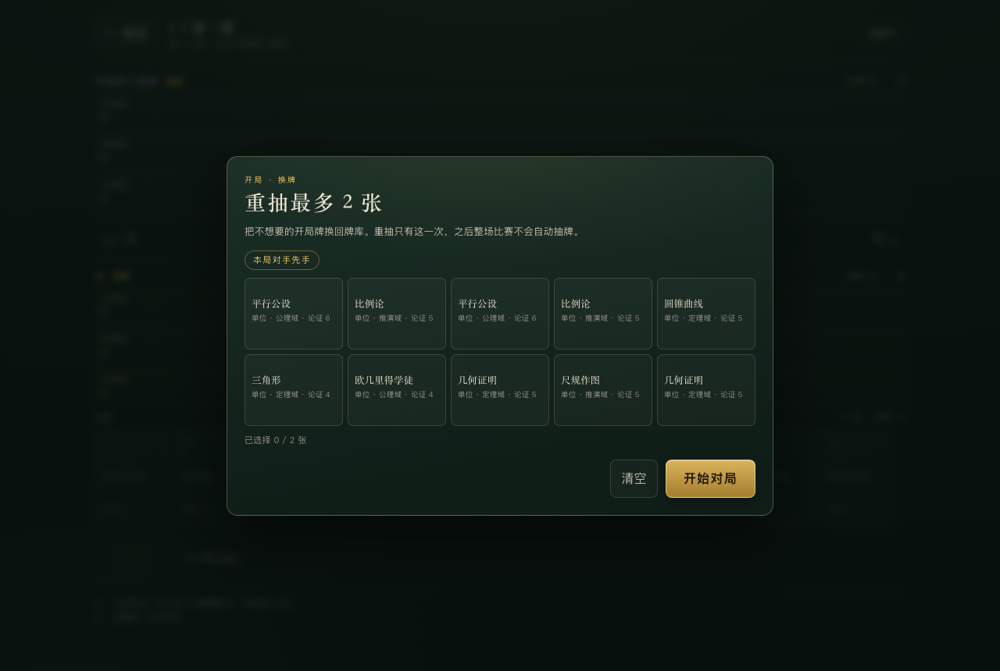
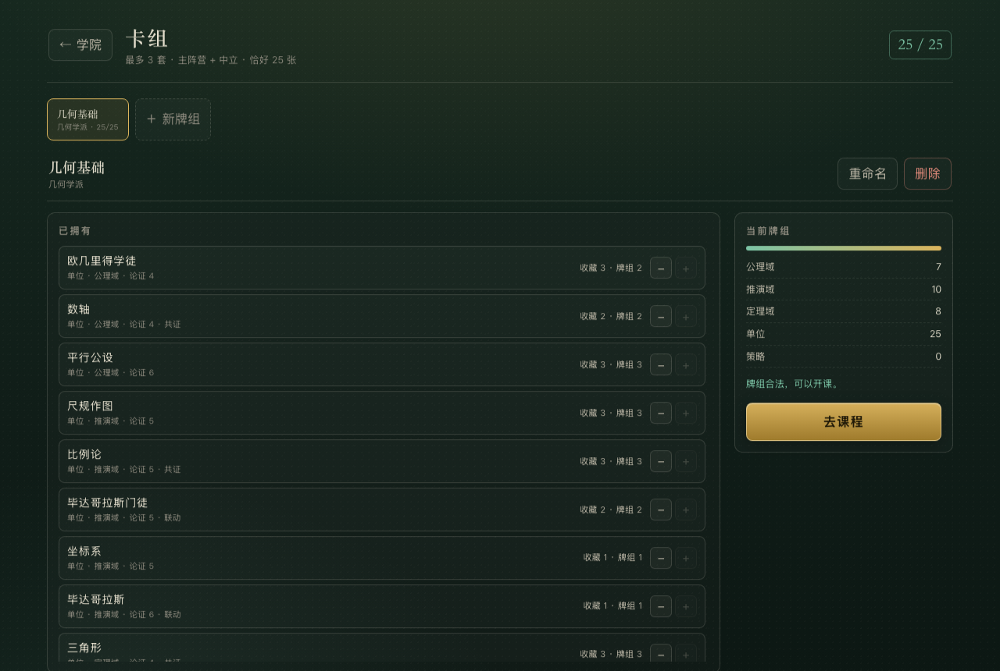

# 真理学院 · 昆特核心（V2）

数学主题的单机昆特牌。你是真理学院新任「求证者」，用学者与数学对象占据**公理域、推演域、定理域**三排，把论证力压过对手；必要时让掉一小局，把手牌留给下一局。

- 非肉鸽、无抽卡、无商店：卡牌只来自通关奖励。
- 3 排、2 枚真理印记、25 张牌、开局抽 10 张、重抽最多 2 张。
- 小局之间**不自动抽牌**，卡差就是核心资源。
- 纯 HTML / CSS / JS，零外部资源、零依赖，`file://` 双击即玩。
- V2 存档：`truth_academy_save_v2`；旧版 V1 存档不读取、不删除。

当前分支：`gwent-v2-core`。旧 RPG 版本保留在 `main`。

## 运行

```bash
cd truth-academy
open index.html          # 或直接双击
# 需要本地服务时：
python3 -m http.server 8080
```

## 截图










## 第一阶段做了什么

### 对局

- 双方各 **2 枚真理印记**。
- 轮流行动：出一张牌，或 Pass。Pass 后本小局不能再行动；对手 Pass 后，未 Pass 的一方可以连续出牌。
- 双方都 Pass 后比论证力：低者失去 1 枚印记；平局双方各失去 1 枚。
- 任意一方归零即结束；同时归零为平局。最多 3 小局。
- 第一小局先手由掷硬币决定（种子可复现），界面会显示本局谁先手。
- 上一小局胜者先手；平局轮换先手。

### 卡牌

30 种可收集卡：20 单位（14 普通 / 4 高级 / 2 巨匠）、6 策略、4 悖论。

| 机制 | 效果 |
|---|---|
| 巨匠 | 不受悖论、反证法、撤回命题影响 |
| 学派联动 | 与另一张同组牌同时在场时，论证力翻倍 |
| 共证 | 同排每有一张其他友方单位，+2 论证力 |
| 反例 | 对方一排生成 1 点「反例」，自己抽 1 张 |
| 引证 | 从弃牌堆复活一张单位到它所在的排 |
| 学术共识 | 己方所有单位 +2，持续到本小局结束 |
| 反证法 | 摧毁对方论证力最高的非巨匠单位 |
| 撤回命题 | 把己方一张单位收回手牌 |
| 悖论 | 对一整排双方单位施加持续效果 |
| 公理澄清 | 解除一排的悖论 |

> 4 张悖论牌在第一阶段作为敌方机制出现；通关 1-10 后，四种悖论一并进入收藏，30 种卡全部可收集。

### 初始牌组：几何学派

25 张、11 种，全部是单位牌，合法且能通关前几关；没有巨匠，也没有任何主动特殊牌。初始收藏与牌组一致。之后每关先拿到下一关要教的机制牌，形成至少三种方向：

- **几何联动**：毕达哥拉斯门徒 / 勾股定理 / 毕达哥拉斯；
- **分析联动**：极限 / 无穷 / 黎曼；
- **逻辑共证**：集合 / 诺特 / 笛卡尔。

### AI

三层：合法行动枚举 → **连续行动模拟** → Pass 判断。

- `estimateCatchup()` 会把模拟场改成「对手已 Pass，由目标方连续出牌」，再用 Beam Search 逐步打出真实手牌；因此能看到联动、共证在第二张、第三张牌上的增益。
- 追分时打模拟路线 `sequence[0]`，而不是当前即时收益最高的单卡。
- AI 领先时用同一套模拟判断「如果我现在 Pass，对手连续行动能不能反超」，不能反超才 Pass。
- 落后太多、需要 3 张以上才能追、且还有 2 枚印记：主动让局。
- 第 1 小局打满 4 张后收手；赢下第 1 小局后，第 2 小局可「干 Pass」。

### 关卡

10 关，难度来自 AI 牌组成熟度：

| 关卡 | 教学 | 对手 | 首通奖励 |
|---|---|---|---|
| 1-1 | 出牌、三排、比分 | 学徒欧几里得 | 毕达哥拉斯 |
| 1-2 | Pass 与卡差 | 芝诺 | 集合 |
| 1-3 | 共证 / 联动 | 共证讲师 | 撤回命题 |
| 1-4 | 撤回命题 | 命题回收员 | 反例 |
| 1-5 | 反例 | 反例工坊主 | 公理澄清 + 三选一：极限 / 无穷 / 笛卡尔 |
| 1-6 | 悖论与公理澄清 | 悖论看守 | 引证 |
| 1-7 | 引证 | 引证学士 | 反证法 |
| 1-8 | 反证法 | 归谬法官 | 三选一：高斯 / 诺特 / 黎曼 |
| 1-9 | 学术共识与综合 | 综合辩手 | 学术共识 |
| 1-10 | Boss · 自指 | 自指者 | 欧几里得·巨匠 + 四种悖论解禁 |

固定奖励在通关时自动发放；三选一可以重复挑战，没选走的牌不会消失，下一次通关仍会出现在选项里。每关的 AI 牌组严格不提前使用未教学的主动机制——这条规则由 `data.js` 的 `MECHANIC_INTRO_STAGE` 定义，测试会自动扫描。

Boss「自指」：第 2、3 小局开始时，随机一排自动被罗素悖论笼罩（论证力减半）。通关后四种悖论解锁，可编入牌组。

### 试玩记录（本地）

主页 →「试玩记录」。它不是自动对战，也不是 AI 模拟：**只有你主动点「开始对局」并实际打完一盘，才会记录一条。**

记录内容包括：关卡、胜负、小局数、真理印记、第一小局投入几张、玩家第一次 Pass 前打了几张、有没有在下一盘前换牌、领取的奖励。数据写在独立的 `truth_academy_playtest_v1`，不进入 V2 游戏存档，可单独清空。


### 收藏与牌组

- 收藏只记录 `卡牌 id → 数量`；普通同名上限 3，巨匠 1。
- 卡组编辑器：左边已拥有，右边当前牌组；加减一张、25/25 计数、合法性检查。
- 固定奖励通关自动发放；三选一领取后立刻进入收藏，可马上编入牌组。
- 刷新页面后收藏、牌组、通关进度全部保留。

## 项目结构

```
truth-academy/
├── index.html
├── css/style.css           黑板粉笔视觉、战斗布局、响应式
├── js/
│   ├── data.js             30 张卡、初始/AI 牌组、10 关、奖励
│   ├── battle.js           纯战斗引擎（Node 可测、rngState 可序列化）
│   ├── ai.js               合法行动、连续追分模拟、Pass 判断、换牌
│   ├── meta.js             V2 存档、收藏、牌组、解锁、奖励
│   ├── playtest.js         本地试玩记录（独立存储，不改规则）
│   ├── ui.js               主页 / 课程 / 卡组 / 图鉴 / 战斗
│   └── main.js             启动
├── test/
│   ├── engine.test.js      44 条规则与档案测试
│   ├── playtest.test.js    6 条试玩记录测试
│   ├── sim.js              AI vs AI 全章模拟
│   └── browser.js          Chrome UI 闭环验收
└── docs/
    ├── design-spec-v2.md   第一阶段规则冻结
    ├── design-spec.md      旧 RPG 版设计（保留）
    └── *.png               截图
```

## 测试

```bash
npm test          # 50 条引擎 / AI / 存档 / 试玩记录测试
npm run sim       # AI vs AI 跑完 1-1 ～ 1-10
npm run qa        # Chrome 真实 UI：换牌、出牌、目标选择、结算、领奖、编辑牌组、刷新读档
```

`npm run qa` 需要 macOS 上的 Google Chrome，使用 `/tmp/ta-v2-cdp-profile` 作为隔离浏览器 profile。

## 设计备注

- **为什么悖论要通关后才解锁**：4 张悖论牌先作为第一章敌方机制，让 1-6、1-10 的排效果有存在感；通关 1-10 后一次性解禁，避免为了凑满 30 种而把 Boss 奖励拆碎。
- **为什么联动是翻倍而不是乘数量**：3 张同组牌乘 3 会让分析/几何堆叠过度膨胀；翻倍保留「凑对」的爽感，也更好平衡。
- **为什么 AI 会主动 Pass**：验收重点不是 AI 会 Combo，而是懂得「这一局要不要继续投入」。因此 AI 有第 1 小局手牌预算和赢下首局后的干 Pass。追分能力按每张实体手牌统计，三张同名卡会算三份。
- **为什么没有升级/抽卡**：第一阶段只验证「三排 + Pass + 卡差 + 奖励进牌组」这条闭环。数值成长、商店、第二学派留到第二阶段。

## 第二阶段（不在本次范围）

商店 / 金币 / 卡包 / 完整收藏界面 / 卡面插画 / 第二学派 / 多套牌 / PvP / 排行榜 / 剧情演出。悖论牌已在 1-10 通关后进入收藏；第二阶段扩展悖论构筑、卡面与完整图鉴。
