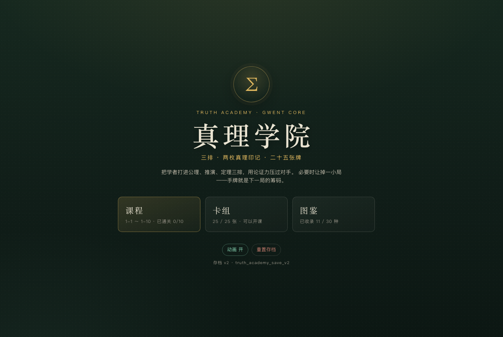
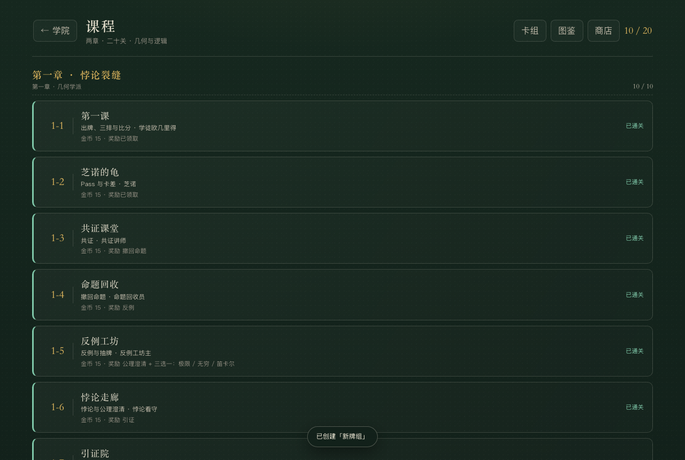
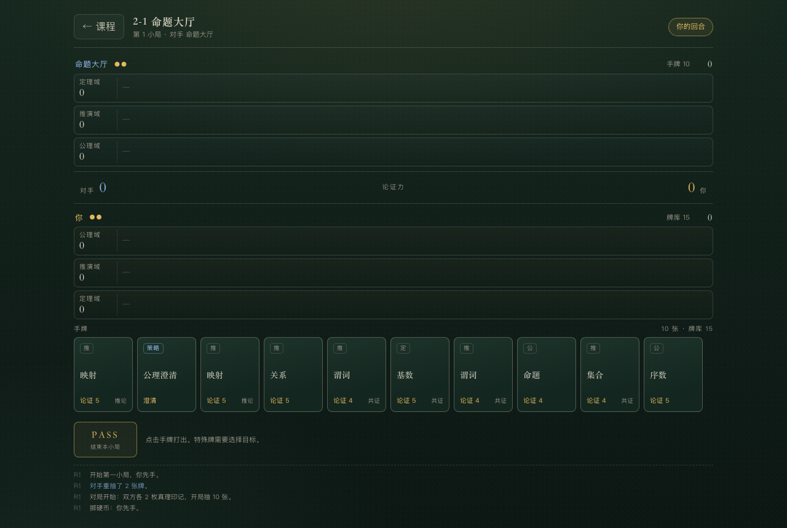
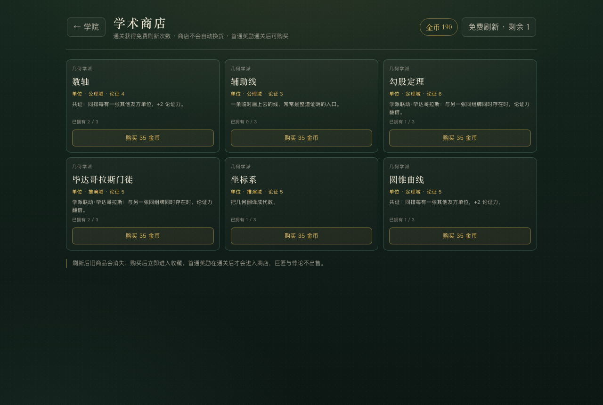
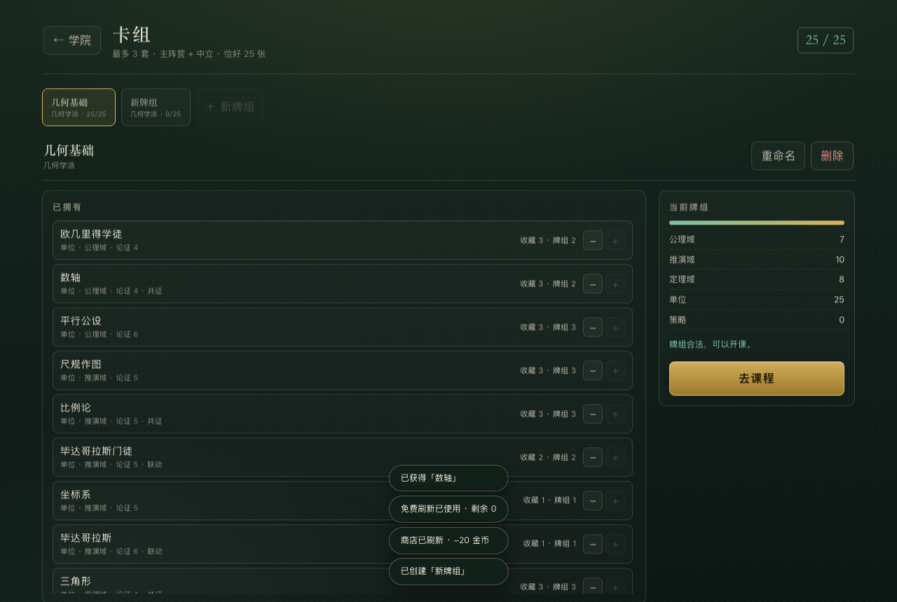
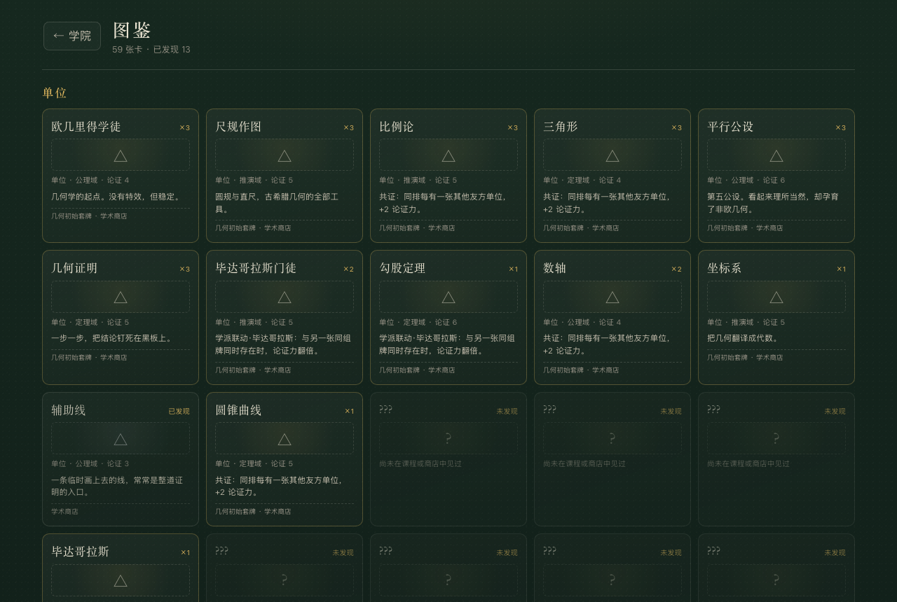
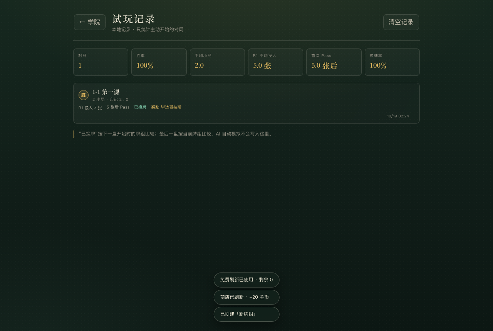

# 真理学院 · 昆特核心（V2 第二阶段）

数学主题的单机昆特牌。三排、两枚真理印记、25 张牌；用论证力、Pass 与卡差赢下小局，收集学者与数学成果，组出几何或逻辑与集合并列的两套不同构筑。

- 两个正式阵营：几何学派、逻辑与集合；中立牌可进入任意阵营牌组。
- 两章 20 关：第一章「悖论裂缝」、第二章「形式之塔」。
- 59 种可收集卡：30 张第一阶段卡 + 29 张第二阶段扩展（逻辑与集合为主，含 1 张几何商店基础牌）。
- 金币、学术商店、三套牌组、三态图鉴、卡牌详情、V2 旧存档自动迁移。
- 纯 HTML / CSS / JS，零外部依赖，`file://` 双击即玩。
- 存档：`truth_academy_save_v2`；试玩记录：`truth_academy_playtest_v1`。

当前分支：`gwent-v2-core`。第一阶段规则见 [design-spec-v2.md](docs/design-spec-v2.md)，第二阶段见 [design-spec-phase2.md](docs/design-spec-phase2.md)。

## 运行

```bash
cd truth-academy
open index.html          # 或直接双击
# 需要本地服务时：
python3 -m http.server 8080
```

## 截图















## 第二阶段完成内容

### 金币与商店

- 初始 150 金币；首通普通关 40 / Boss 100（第二章 60 / 150），重复通关 15 / 30。
- 商店 6 个槽位；通关获得 1 次免费刷新（上限 3），不会自动换货；没有免费次数时手动刷新 20 金币。
- 首通奖励在对应关卡通关后才进入商店；巨匠与悖论不进入随机池。
- 购买立即进入收藏；达到同名上限后显示「已满」；已售出的槽位不能重复购买。
- 商店库存写入 `profile.shop`，刷新页面不会重新随机。

### 多牌组与阵营

- 最多 3 套玩家牌组，可新建、切换、重命名、删除；1-10 系统赠送的逻辑套牌不受普通上限影响。
- 每套牌选择主阵营：`geometry` 或 `logic`；只能加入主阵营牌与 `neutral` 牌。
- 每套牌恰好 25 张，同名上限 3，巨匠 1。
- 通关 1-10 解锁逻辑与集合，赠送一套 25 张合法逻辑初始牌组。

### 图鉴三态

- **已拥有**：完整卡名、卡面、能力、来源、拥有数量。
- **已发现未拥有**：曾出现在商店或敌方战场，显示完整信息但灰化。
- **未发现**：`???` 与卡背，不暴露名字与效果。
- 统一卡牌详情弹层：阵营、战线、论证力、机制、描述、拥有数量、牌组数量、获取来源、商店等级。

### 逻辑与集合

新增 29 张卡，包括命题、谓词、关系、映射、形式语言、证明树、模型、基数、序数、康托尔、罗素、希尔伯特、弗雷格、布尔、图灵、哥德尔、策梅洛、弗兰克尔、塔斯基等，以及康托尔·巨匠、哥德尔·巨匠。

新增四个机制：

- **否定**：取消对方最近打出的一张策略牌效果。
- **对角线**：对方一排至少 3 个单位时，在己方对应排生成 3 点「自指命题」。
- **推论**：若上一张牌是逻辑单位，本牌 +4 论证力。
- **公理化**：使一个普通单位本小局不受悖论影响。

### 第二章「形式之塔」

| 关卡 | 教学 | 首通奖励 |
|---|---|---|
| 2-1 | 逻辑基础 | 命题 |
| 2-2 | 集合与基数 | 康托尔 |
| 2-3 | 否定 | 逻辑否定 |
| 2-4 | 推论 | 模型 |
| 2-5 | 对角线 | 对角线法 |
| 2-6 | 公理化 | 形式化 |
| 2-7 | 控制与卡差 | 希尔伯特 |
| 2-8 | 综合逻辑 | 三选一：康托尔·巨匠 / 罗素 / 图灵 |
| 2-9 | 不完备 | 哥德尔 |
| 2-10 | Boss · 不完备性定理 | 哥德尔·巨匠 |

Boss「不完备」：第 2、3 小局开始时，随机一排自动被不完备性危机笼罩（-3）。

### AI

- 连续追分模拟 `estimateCatchup()` + Beam Search，能看到联动、共证、推论在第二、三张牌上的增益。
- AI 领先时用同一模拟判断对手能否反超，不能反超才安全 Pass。
- 20 关各自有 `AI_PROFILES`：aggression / conserve / bluff / comboBias / controlBias 调整第一局预算、干 Pass、控制牌与组合偏好。
- 敌人打出的新卡会写入 `discoveredCards`，进入图鉴「已发现」状态。

### 存档迁移

旧第一阶段 V2 档案（`deck: []`）会自动迁移为：

```text
deck -> decks[0].cards
collection / clearedStages / claimedRewards / discoveredCards 全部保留
gold / unlockedFactions / unlockedChapters / shop 使用默认值
```

不会清空收藏、通关或牌组；不需要重新开档。

### 试玩记录

主页「试玩记录」只统计玩家主动开始并打完的对局，AI 模拟不写入。记录 R1 投入张数、首次 Pass 前张数、换牌、金币与奖励；独立存储，可单独清空。

## 内容量

| 项目 | 数量 |
|---|---|
| 可收集卡 | 59 |
| 阵营 | 2（几何、逻辑与集合）+ 中立 |
| 章节 / 关卡 | 2 / 20 |
| 第二阶段新增卡 | 29 |
| 新机制 | 4（否定、对角线、推论、公理化） |
| 牌组 | 最多 3 套玩家牌组 + 系统逻辑套牌 |
| 商店槽位 | 6 |
| 试玩记录 | 80 条上限 |

## 项目结构

```text
truth-academy/
├── index.html
├── css/style.css           黑板粉笔视觉、卡框、商店、响应式
├── js/
│   ├── data.js             59 张卡、20 关、阵营、AI 牌组与性格、来源
│   ├── battle.js           纯战斗引擎（含否定 / 对角线 / 推论 / 公理化）
│   ├── ai.js               连续追分模拟、Pass 判断、AI 性格
│   ├── meta.js             V2 档案、金币、多牌组、阵营、奖励、迁移
│   ├── shop.js             商店池、刷新、价格、购买
│   ├── playtest.js         本地试玩记录
│   ├── ui.js               主页 / 课程 / 卡组 / 图鉴 / 商店 / 战斗
│   └── main.js             启动
├── test/
│   ├── engine.test.js      45 条规则与档案测试
│   ├── playtest.test.js    6 条试玩记录测试
│   ├── phase2.test.js      35 条第二阶段测试
│   ├── sim.js              两学派 / 两章 AI 模拟
│   └── browser.js          Chrome UI 闭环验收
└── docs/
    ├── design-spec-v2.md
    ├── design-spec-phase2.md
    └── *.png
```

## 测试

```bash
npm test          # 86 条：规则 / 档案 / 试玩记录 / 商店 / 第二章
npm run sim       # 几何与逻辑牌组跑两章，输出 R1 投入、Pass、剩余手牌、分差
npm run qa        # Chrome：1-1、商店、多牌组、1-10 解锁、2-1、刷新存档
```

`npm run qa` 需要 macOS 上的 Google Chrome，使用 `/tmp/ta-v2-cdp-profile` 作为隔离 profile。

## 设计备注

- **金币是唯一新增货币**：没有体力、碎片、抽卡或付费；金币只用来买商店卡与刷新。
- **商店不卖巨匠与悖论**：首通奖励要打通对应关卡后才进入商店，商店只补齐重复卡与构筑零件。
- **阵营不是数值差**：几何靠共证/联动/稳定堆排；逻辑靠否定、对角线、推论与控制，改变交换节奏。
- **旧存档不炸**：第二阶段继承第一阶段 V2，不重开；迁移逻辑有独立测试。
- **Pass 仍是核心**：第二阶段的商店、牌组、AI 性格都只服务于三排博弈，不引入等级、装备或单位血量。

## 不包含

PvP、联网、排行榜、每日任务、真实付费、SSR 抽卡、角色等级、突破、装备、碎片合成、Battle Pass、活动系统、第三 / 第四学派、无限关卡、Roguelike。
